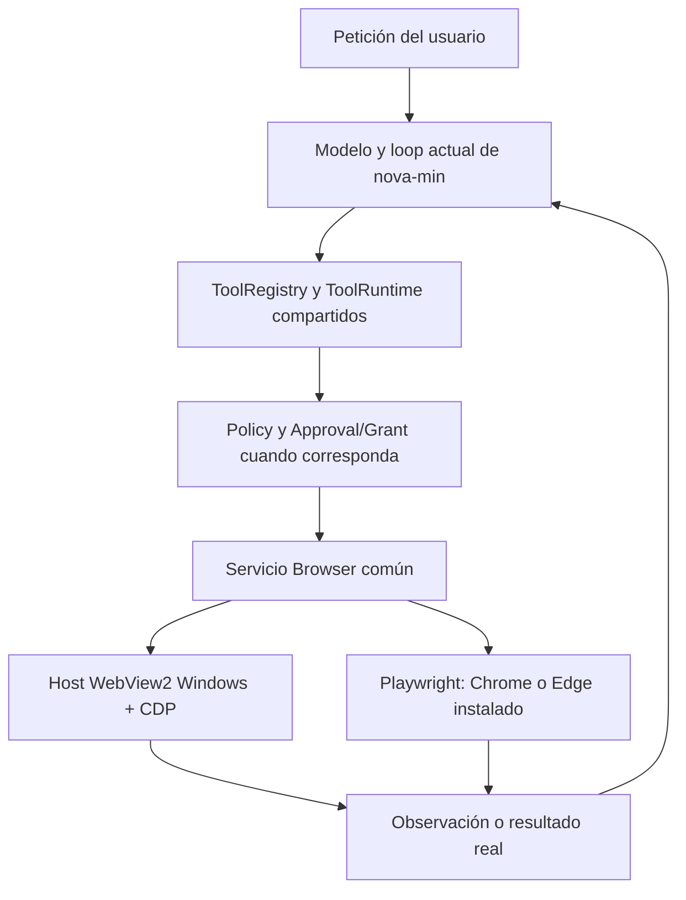

# Active Web: auditoría de reutilización y bloques propuestos

Fecha: 2026-10-14. Estado: propuesta para revisión humana; implementación pendiente.

## 1. Alcance y conclusión

Origen auditado: `C:/Users/joseh/Downloads/nova-local-cli/nova-assistant`.
Base propuesta para implementar: `C:/Users/joseh/Downloads/nova-min/nova-assistant`.
El origen tiene HEAD `ef5c3645af06b9f151a0137a6b6ca2fada22d48f` y cambios locales, incluidos archivos sin seguimiento. Esta revisión corresponde al árbol actual, no exclusivamente a ese commit.

La recomendación es rescatar componentes y pruebas concretas, y construir una composición nueva y pequeña sobre nova-min. Copiar Active Web completo trasladaría precisamente las dependencias y restricciones que causaron fricción.

Diseño propuesto:

- Windows como único sistema implementado, probado y soportado inicialmente.
- WebView2 Fixed Version incluido con Nova y seleccionado por defecto.
- Chrome y Edge instalados como alternativas mediante Playwright.
- Operaciones comunes de navegación e interacción compartidas entre backends.
- El modelo elige las acciones; Application/ToolRuntime valida sus efectos.
- Búsqueda mediante el navegador seleccionado, sin depender de SearXNG ni de una API de pago.
- Fetch HTTP y terminal conservan sus herramientas, elección del usuario y controles actuales de nova-min.
- La preparación para Linux/macOS consiste en separar el arranque específico de Windows del código común; no constituye soporte ni validación en esas plataformas.

Auditoría estática: lectura de fuentes, configuración, pruebas y documentos seleccionados; comparación de hashes con el candidato que selecciona el origen. No se ejecutaron builds, navegadores, pruebas ni campañas históricas. No se modificaron productos, preferencias personales ni evidencia histórica. Este documento es el entregable nuevo.

## 2. Hallazgos causales

### A-01. La disponibilidad depende de documentación histórica

[bootstrap_web_v12.py:92](C:/Users/joseh/Downloads/nova-local-cli/nova-assistant/local_cli/bootstrap_web_v12.py:92) selecciona un candidato dentro de `docs/post_hux_browser_takeover_epoch_sync/`. Su carga exige el esquema histórico y los pins del ejecutable y assembly.

[web_discovery_v12.py:120](C:/Users/joseh/Downloads/nova-local-cli/nova-assistant/local_cli/infrastructure/web_discovery_v12.py:120) compara hashes de fuentes antes de probar el host; después exige igualdad de runtime, configuración, familia de Policy, esquema, protocolo y componentes.

Comprobación de sólo lectura: el perfil Browser tiene 139 pins; hay ocho discrepancias actuales:

```text
local_cli/agent.py
local_cli/application/session.py
local_cli/application/tool_runtime.py
local_cli/bootstrap_cli.py
local_cli/bootstrap_server.py
local_cli/bootstrap_web_v12.py
local_cli/cli.py
local_cli/interfaces/cli_application.py
```

El candidato registra WebView2 `155.0.4283.45`, SDK `1.0.4258.31`, X64. El primer mismatch basta para devolver `SOURCE_IDENTITY_MISMATCH` antes del probe nativo. No demuestra que el motor instalado falle.

**Decisión:** no trasladar estos manifiestos a la disponibilidad del nuevo producto. Comprobar instalación, arranque y operaciones compatibles. La integridad del paquete y las versiones de sus dependencias pertenecen al empaquetado y mantenimiento, sin convertir cada edición del repositorio en una desactivación del navegador.

### A-02. La ruta directa ya existe, pero conserva otros bloqueos

El origen actual activa `direct_model_tool_selection=True` en sus bootstrap y desactiva las lanes HUX en [session.py:253](C:/Users/joseh/Downloads/nova-local-cli/nova-assistant/local_cli/application/session.py:253). No es correcto atribuir todos los fallos actuales al router HUX histórico.

Las lanes que sí deben quedar fuera están en [harness_ux_lanes.py:182](C:/Users/joseh/Downloads/nova-local-cli/nova-assistant/local_cli/application/harness_ux_lanes.py:182): clasifican frases, bloquean mezclas de tareas y requieren transiciones especiales.

La ruta directa conserva manifests, routing web, esquemas extensos y gates de proveedor. Además, [functional_loop.py:47](C:/Users/joseh/Downloads/nova-local-cli/nova-assistant/local_cli/application/functional_loop.py:47) puede sustituir la respuesta final por un fallo anterior que no se limpió; los fallos web se registran en esa lista. Es un riesgo de recuperación aunque otra llamada posterior tenga éxito; esta revisión no lo reprodujo en ejecución.

**Decisión:** usar como base el loop existente de nova-min. Rescatar ideas de resultados tipados, límites y catálogo dinámico del loop directo; no copiarlo íntegramente ni añadir otro loop paralelo.

### A-03. Hay un motor WebView2 real, pero no está autocontenido

[WebView2Runtime.cs:17](C:/Users/joseh/Downloads/nova-local-cli/nova-assistant/native/nova-browser-host/WebView2Runtime.cs:17) consulta el runtime instalado y crea el entorno con `CreateAsync(null, udf, options)`. No selecciona un directorio Fixed Version incluido en la aplicación.

El [proyecto nativo](C:/Users/joseh/Downloads/nova-local-cli/nova-assistant/native/nova-browser-host/nova-browser-host.csproj:4) usa WinForms, .NET 10, x64 y SDK WebView2 `1.0.4258.31`. El launcher Python utiliza un `dotnet.exe` externo y un assembly.

**Decisión:** extraer el anfitrión mínimo y añadir la ruta privada del runtime incluido. Publicar el host autocontenido para evitar una instalación manual de .NET. El SDK, loader, runtime WebView2, driver de Playwright y dependencias de Nova deben formar parte del paquete correspondiente; un único instalador puede contener varios ejecutables y carpetas.

### A-04. El adaptador Playwright antiguo no sirve como sustitución directa

[playwright_adapter.py:249](C:/Users/joseh/Downloads/nova-local-cli/nova-assistant/local_cli/infrastructure/active_web/playwright_adapter.py:249) exige un broker/proxy y un probe antes de lanzar Chromium. Su configuración incluye bloqueo de Service Workers, cambios de DNS y flags de WebRTC/QUIC. No implementa selección de canales Chrome/Edge instalados ni conexión Playwright a WebView2.

El host WebView2 llama realmente a CDP en [ObservationRuntime.cs:69](C:/Users/joseh/Downloads/nova-local-cli/nova-assistant/native/nova-browser-host/ObservationRuntime.cs:69), pero sus observaciones y varias acciones usan JavaScript fijo propio. Eso no equivale a Playwright conectado al WebView2.

**Decisión:** extraer únicamente patrones útiles de worker asíncrono, ciclo de vida y operaciones. Crear el conector WebView2/CDP y el launcher Chrome/Edge. No trasladar proxy obligatorio, exclusividad de red, supresión de protocolos ni sus probes.

### A-05. La navegación común está restringida en el host

[ObservationRuntime.cs:29](C:/Users/joseh/Downloads/nova-local-cli/nova-assistant/native/nova-browser-host/ObservationRuntime.cs:29) permite una URL exacta previamente admitida o navegación humana durante takeover; consume el permiso y las redirecciones necesitan autoridad nueva. [ExternalProtocolGuard.cs:62](C:/Users/joseh/Downloads/nova-local-cli/nova-assistant/native/nova-browser-host/ExternalProtocolGuard.cs:62) bloquea cualquier popup.

El catálogo productivo también excluye acciones de navegación ya presentes en infraestructura, según [ProductiveProtocol.cs:40](C:/Users/joseh/Downloads/nova-local-cli/nova-assistant/native/nova-browser-host/ProductiveProtocol.cs:40). Las observaciones existentes cubren sólo ciertos elementos y frames del mismo origen; no acreditan cobertura de todas las páginas.

**Decisión:** no copiar esas restricciones como comportamiento nuevo. Probar navegación, redirecciones normales, enlaces con query/fragment, atrás/adelante, recarga, formularios de búsqueda y ventanas hijas administradas. Mantener mediación para lanzar aplicaciones externas y para permisos del sitio; no confundir esas operaciones con abrir otra página HTTP(S).

### A-06. El modelo recibe demasiada contabilidad interna

[browser_actions_v12.py:24](C:/Users/joseh/Downloads/nova-local-cli/nova-assistant/local_cli/application/browser_actions_v12.py:24) obliga al modelo a repetir capability, sesión, página, observación, elemento, epoch y versión. Hasta navegar requiere un ElementRef.

Hay además una posible brecha de inicio: [session.py:2417](C:/Users/joseh/Downloads/nova-local-cli/nova-assistant/local_cli/application/session.py:2417) expone sólo las herramientas Browser con prefijo `browser_`, mientras la apertura/navegación inicial vive en el trayecto interactivo de `web_access`. El navegador expuesto puede pedir referencias que todavía no existe una herramienta sencilla para obtener. Esto es una inferencia del código, no una reproducción nativa.

**Decisión:** ofrecer operaciones pequeñas desde una sesión vacía. Application resuelve sesión/página actual y los bindings internos desde refs opacas, sin pedir al LLM epochs, grants ni versiones. Un ref obsoleto exige una observación nueva; no un parche sobre un Grant viejo.

### A-07. Search sigue acoplado a SearXNG y a filtros léxicos

El origen limita proveedor y queries en [research_contracts.py:59](C:/Users/joseh/Downloads/nova-local-cli/nova-assistant/local_cli/application/research_contracts.py:59). [functional_web.py:24](C:/Users/joseh/Downloads/nova-local-cli/nova-assistant/local_cli/application/functional_web.py:24) instruye a reutilizar palabras del humano y no añadir temas o fechas. Su fetch distingue `displayUrl` de `resultRef` mediante un ledger adicional.

En nova-min el proveedor pasivo está deshabilitado por defecto, pero la herramienta se anuncia: [bootstrap_passive_web.py:6](C:/Users/joseh/Downloads/nova-min/nova-assistant/local_cli/bootstrap_passive_web.py:6). El error actual es visible y tipado; no se constató un crash de la CLI por ese caso.

**Decisión:** `web_search(query)` se ejecutará con el navegador elegido; SearXNG dejará de ser requisito. Las fuentes conservarán URL y procedencia claras, sin obligar a usar el motor de discovery viejo. No introducir allowlists de palabras de la petición ni fases semánticas obligatorias de research.

### A-08. Algunas piezas útiles están acopladas a más política de la necesaria

[V12FixedActionPort:59](C:/Users/joseh/Downloads/nova-local-cli/nova-assistant/local_cli/application/browser_actions_v12.py:59) degrada a UNKNOWN los reportes de acciones distintas de navegación una vez iniciadas. Es útil evitar afirmar un resultado remoto que no se observó, pero trasladar toda esa composición impediría distinguir con sencillez una interacción local confirmada de una operación remota incierta.

El takeover está enlazado a checkpoints y continuidad sensible. [CurrentPageBindings](C:/Users/joseh/Downloads/nova-local-cli/nova-assistant/local_cli/application/current_page_binding.py:55) aporta identidad/frescura, pero su selección humana depende de regex en `is_human_current_page_request`.

**Decisión:** rescatar las garantías prácticas: receipts reales, pausa humana, observación fresca, ocultamiento de credenciales y no reintentar una mutación incierta. La página actual debe ser estado de sesión normal, utilizable por el modelo, sin un clasificador de frases deícticas. Definir el resultado observable de cada operación sin convertir UNKNOWN remoto en éxito ni congelar toda futura lectura por un fallo recuperable.

## 3. Lista de rescate

Las decisiones siguientes autorizan una propuesta de extracción futura, no una copia ya realizada ni un PASS heredado.

| Pieza | Decisión | Qué aprovechar / qué adaptar |
|---|---|---|
| [WebView2Runtime.cs](C:/Users/joseh/Downloads/nova-local-cli/nova-assistant/native/nova-browser-host/WebView2Runtime.cs:63) | Extraer | STA, dispatch de UI, control de procesos, perfiles propios, creación/cierre. Cambiar selección de runtime, visibilidad e integración CDP. |
| [BrowserHostClient](C:/Users/joseh/Downloads/nova-local-cli/nova-assistant/local_cli/infrastructure/active_web/browser_host.py:97), [NativePipe](C:/Users/joseh/Downloads/nova-local-cli/nova-assistant/native/nova-browser-host/NativePipe.cs:40), [ProcessJob](C:/Users/joseh/Downloads/nova-local-cli/nova-assistant/local_cli/infrastructure/active_web/host_process_job.py:29) | Extraer | Arranque sin shell, canal local privado, correlación, deadlines, cierre de procesos propios. Reducir comandos al control de host necesario. |
| [ProductiveBrowserComposition](C:/Users/joseh/Downloads/nova-local-cli/nova-assistant/local_cli/infrastructure/active_web/productive_v12.py:111) | Referencia | Resolver snapshots vigentes desde el manager; no cachear un epoch anterior al takeover. No importar la factory ni toda su cadena de dependencias. |
| [BrowserObservationService](C:/Users/joseh/Downloads/nova-local-cli/nova-assistant/local_cli/application/browser_observation.py:76) y observaciones nativas | Extraer | Límites de texto, refs opacas, revalidación del elemento, invalidación por navegación. Rehacer la proyección sobre el backend común Playwright. |
| [ExternalProtocolGuard](C:/Users/joseh/Downloads/nova-local-cli/nova-assistant/native/nova-browser-host/ExternalProtocolGuard.cs:31) | Adaptar | Interceptar aperturas de aplicaciones externas. Separar ese control de la gestión de ventanas/pestañas web y del journal histórico. |
| [TransferRuntime](C:/Users/joseh/Downloads/nova-local-cli/nova-assistant/native/nova-browser-host/TransferRuntime.cs:58), [webview2_file_selection.py](C:/Users/joseh/Downloads/nova-local-cli/nova-assistant/local_cli/infrastructure/active_web/webview2_file_selection.py:19), staging | Extraer después | Identidad de archivo, tamaño/digest, archivos propios, cancelación de descargas no solicitadas y finalización observada. Su selección de archivo no es un picker gráfico ya construido. |
| [TakeoverRuntime](C:/Users/joseh/Downloads/nova-local-cli/nova-assistant/native/nova-browser-host/TakeoverRuntime.cs:11) | Extraer después | Ventana humana, pausa del agente, devolución de control y frescura. No copiar sin revisar su acoplamiento al protocolo sensible completo. |
| [FunctionalToolView](C:/Users/joseh/Downloads/nova-local-cli/nova-assistant/local_cli/application/functional_tools.py:32) | Referencia opcional | Schemas y nombres claros; por ejemplo shell/PowerShell. No cambiar innecesariamente herramientas locales al implementar Browser. |
| Policy / Approval / Grant / ToolRuntime de nova-min | Conservar | Integrar efectos Browser explícitamente en el camino existente. No instalar una segunda autoridad Browser. |
| Tests y páginas owned | Reutilizar casos | Adaptar escenarios a contratos nuevos; no heredar denominadores ni estados PASS históricos. |

## 4. Lo que debe quedar fuera del traslado

- `bootstrap_active_web.py`, `bootstrap_web_v12.py`, `WebV12Discovery`, manifiestos y pins históricos como requisito operativo.
- La factory productiva antigua completa y sus perfiles de certificación.
- Router léxico, lanes, presupuestos por intención, postcondiciones HUX por workflow y fases obligatorias de research.
- Broker/proxy obligatorio del navegador, supresión de WebRTC/SW/QUIC y búsqueda de aislamiento universal de sockets.
- Denial ledger de Fetch como prohibición independiente sobre Browser. Una denegación real de Policy sigue aplicándose; un 403, timeout, incompatibilidad de transporte o truncamiento no se convierte en prohibición global del navegador.
- Tickets de URLs que exijan que el humano haya escrito cada dirección o no admitan queries normales.
- Filtros de vocabulario que impidan al modelo formular una búsqueda pública razonable.
- Catálogos productivos que pidan al modelo `navigationEpoch`, Policy revision, Grant o IDs internos.
- Selección inicial obligatoria cuando todavía no hay una preferencia guardada, incluso ofreciendo sólo WebView2; palabra especial `ACEPT` para habilitar lectura ordinaria, y activaciones separadas para buscar. La selección antigua sí se guarda; no exige repetirla en cada arranque.
- Denegar todos los popups, eliminar todas las queries/fragments o tratar toda página como un caso offline.
- Copiar el parser HTTP V1.2: [controlled_fetch_transport.py:162](C:/Users/joseh/Downloads/nova-local-cli/nova-assistant/local_cli/infrastructure/controlled_fetch_transport.py:162) rechaza cualquier Transfer-Encoding, incluido chunked. Eso explica una clase de incompatibilidad posible con respuestas normales; no demuestra la causa de cada servidor del historial sin su respuesta concreta.
- Importar carpetas de evidencia, freezes, perfiles personales, UDF históricos, bin/obj, caches, antiguos journals, campañas de 561/102 ejecuciones o el inventario CI completo del origen.

No se eliminan esas piezas del origen ni se cambian sus resultados históricos. La nueva implementación tiene alcance y resultados propios.

## 5. Arquitectura mínima propuesta



El host WebView2 administra ventana, runtime, perfil y procesos. Playwright realiza las operaciones de páginas. Evitar dos pipelines de acciones: uno antiguo por IPC y otro nuevo por Playwright. El IPC que se rescate sirve para controlar el host, no para duplicar Policy y acciones.

El modelo ve un catálogo estable y sencillo. Ejemplos propuestos, todavía no implementados:

```text
web_search(query)
web_fetch(url)                    # HTTP existente, opcional
browser_navigate(url, page?)      # crea sesión/página si hace falta
browser_observe(page?)
browser_click(ref)
browser_type(ref, text)
browser_press_key(key, ref?)
browser_back(page?)
browser_forward(page?)
browser_close(page?)
```

`page?` es opcional cuando existe una página actual inequívoca. Los detalles de epoch, observación y binding quedan detrás de las refs; no son argumentos que el modelo deba reconstruir. Una página ambigua exige selección clara; un elemento cambiado devuelve un error accionable y permite observar de nuevo.

`web_search` Browser no puede heredar sin cambios el caso especial S5 de nova-min: [policy.py:171](C:/Users/joseh/Downloads/nova-min/nova-assistant/local_cli/application/policy.py:171) y ToolRuntime actualmente interpretan ese nombre como búsqueda HTTP a un proveedor. Es necesario instalar una operación Browser explícita y su intención de efecto, sin ejecutar Playwright por el fallback genérico de `tool.execute`.

No se necesita un framework de plugins, un cliente MCP, GUI nueva, voz ni una máquina de estados semántica para esta etapa.

## 6. Permisos con poca fricción

- Navegar, leer y buscar: evaluados mediante el permiso Browser normal; sin Approval adicional creada sólo por llamarse Browser.
- Click/input: validar destino/ref y contexto; pedir aprobación para los efectos que la política acordada realmente lo requiera. La etiqueta de un botón no demuestra que sea inocuo. Resolver expresamente la escritura de queries y su envío al buscador como parte de la operación de búsqueda, sin el teatro de múltiples aprobaciones por una consulta pública normal.
- Upload/download, credenciales, compras, borrados y lanzamientos externos: aplicar la Policy existente y las aprobaciones correspondientes. No usar la simplificación de UX para aprobar un efecto desconocido.
- Permisos de cámara, micrófono, ubicación o portapapeles: mediación explícita del host. No se encontró un handler productivo `PermissionRequested` en el host auditado; es un hueco a cubrir, no una protección heredada.
- Una aprobación no cambia una denegación de Policy. Cada ejecución pasa por ToolRuntime y obtiene su autoridad vigente; elegir navegador no concede autoridad sobre todas sus acciones.
- Mantener receipts, cancelación, redacción de credenciales y limpieza de recursos propios. No afirmar borrado forense ni aislamiento de red del navegador.
- Un timeout tras una acción potencialmente mutante puede ser UNKNOWN: observar es posible cuando sea seguro; repetir el efecto a ciegas no. No presentar ejecución local como prueba del estado del servidor.

Los controles anteriores son internos. La interfaz normal explica el resultado y sólo pide decisiones humanas necesarias. La política de efectos de Browser debe quedar explícita en el primer bloque; no se heredarán silenciosamente ni se desactivarán globalmente las decisiones antiguas.

## 7. Bloques de implementación propuestos

Cada bloque entrega una función utilizable y una validación pequeña. Son bloques de desarrollo, no una nueva certificación B0-B7. La implementación aún no ha comenzado.

### Bloque 1 — Base Browser y host WebView2 incluido

**Entregar:** servicio Browser pequeño, perfiles propios, host Windows extraído, path explícito a Fixed Version, publicación autocontenida del host y conexión Playwright/CDP. Preparar una única versión de dependencias del nuevo paquete después de comprobar disponibilidad y compatibilidad; no copiar ciegamente las versiones viejas.

**Validar en Windows:** el host del paquete arranca, Playwright se conecta al proceso esperado, una página owned ejecuta JS y puede leerse, y se cierra todo lo creado. Probar el paquete sin depender del WebView2 compartido ni de un `dotnet.exe` personal. La conexión CDP debe limitarse al host local administrado y cerrarse con la sesión.

**Salida:** transporte de control y ciclo de vida funcionales. Si el subconjunto necesario de Playwright no funciona con este WebView2, detener la elección técnica aquí y revisar, antes de construir más capas.

### Bloque 2 — Navegación productiva con modelo real

**Entregar:** registrar las tools pequeñas en la Application actual, añadir las capacidades/intent Browser a Policy/ToolRuntime y resolver página/refs internamente. Navegar, observar, pulsar, escribir, usar Enter, volver/avanzar, recargar y cerrar; gestionar enlaces y redirects normales.

**Validar temprano:** el modelo local actualmente elegido por el humano recibe file/shell/web/browser conjuntamente y realiza `abrir página owned → leer contenido JS → click/input autorizado → observar → responder`. Probar también denegación, ref stale, ausencia de runtime y cierre. Al menos una secuencia debe mezclar Browser y una herramienta local, sin lanes.

**Salida:** interacción normal desde `You>` sin comandos administrativos previos ni campos de contabilidad. No esperar a terminar todos los bloques para comprobar que el modelo realmente usa el navegador.

### Bloque 3 — Búsqueda mediante Browser y convivencia con fetch

**Entregar:** `web_search(query)` sobre el navegador seleccionado; buscador web predeterminado configurable por el humano. Reutilizar resultados/procedencia con título, URL y extracto acotados. SearXNG deja de ser la implementación obligatoria; retirar su selección predeterminada de esta composición sin migrar preferencias personales.

**Validar:** búsquedas naturales ES/EN y noticias con fecha relativa; abrir un resultado, leerlo y responder con fuentes realmente obtenidas. Confirmar enlaces con query/fragment y redirecciones. Un snippet no se presenta como artículo leído. Sin resultados/CAPTCHA/bloqueo del sitio produce una explicación honesta y bounded, nunca resultados inventados.

**Convivencia:** `/fetch on|off|status` conserva el control del fetch HTTP. Desactivar fetch no desactiva Browser. El modelo elige entre herramientas operativas; no se instala un router por keywords. Ninguna alternativa pasa por fuera de su Policy.

**Salida:** la tarea que originó la frustración funciona con un navegador real; no exige configurar un servidor SearXNG ni una clave API.

### Bloque 4 — Selección opcional de Chrome y Edge

**Entregar:** launcher compartido Playwright con canales Chrome/Edge, detección del navegador instalado y selección persistente. WebView2 es el valor predeterminado; no preguntar por él en cada arranque. Un comando administrativo propuesto `/browser` puede mostrar estado y cambiar selección; debe figurar en `/help`.

**Validar en Windows:** misma navegación/búsqueda/lectura e interacción pequeña en los backends implementados; confirmar que elegir Chrome/Edge controla ese navegador, no Chromium descargado accidentalmente. Ausencia del navegador genera un error útil y no una descarga o cambio silencioso de preferencia.

**Portabilidad:** operaciones compartidas; rutas, detección y procesos Windows separados. Linux/macOS permanecen sin soporte declarado hasta sus pruebas futuras. No crear adaptadores vacíos ni instalaciones automáticas para simular portabilidad.

### Bloque 5 — Intervención humana y transferencias

**Entregar:** pausa visible para login/CAPTCHA, devolución de control y nueva observación; refs y sesión frescas tras takeover. Upload de un archivo autorizado, download solicitado y ubicación controlada; limpieza y persistencia de artefactos con contrato entendible.

**Validar:** el agente no actúa mientras el humano controla el navegador; dos ciclos de takeover no dejan epochs cacheados. Archivo cambiado/stale se rechaza antes de disclosure. Una descarga interrumpida no aparece como completa. Contraseñas y valores sensibles conocidos no aparecen en observaciones ni logs públicos. No reclamar continuidad universal/DLP ni importar todo el protocolo terminal histórico sin justificarlo.

**Salida:** flujos humanos y archivos utilizables con permisos concretos. Estos mecanismos no deben retrasar la entrega temprana de navegación/búsqueda de los bloques 2-3.

### Bloque 6 — UX y fallos de la composición completa

**Entregar:** estado Browser sencillo, mensajes de interfaz en inglés, idioma del modelo sin imponer, herramientas operativas por generación y resultado estructurado ante fallos. Una condición produce una representación normal única; detalle técnico sólo en debug.

**Validar:** argumentos administrativos inválidos, runtime ausente, cierre humano, página desaparecida, popup administrado, pérdida de conexión, búsqueda sin resultados, proveedor de sitio bloqueado, cancelación y acción incierta. El modelo recibe resultados recuperables y puede continuar con otra acción permitida; ningún fallo de red se convierte automáticamente en prohibición global ni un éxito posterior se oculta tras un error viejo.

**Salida:** no traceback por errores de usuario/capacidad, sin bucles indefinidos ni éxito inventado. CLI y backend usan la misma Application; no se construye un router en Desktop.

### Bloque 7 — Distribución Windows y aceptación práctica

**Entregar:** paquete de Nova con sus dependencias Browser, instrucciones breves, mantenimiento/actualización de Fixed Version y regresión Windows incorporada al CI existente.

**Validar:** arranque desde el paquete sin instalaciones manuales adicionales del navegador integrado; confirmar que el import/ejecutable pertenece a la copia correcta. Ejecutar un corpus pequeño con el modelo adoptado: buscar noticia, investigar Wikipedia, seguir enlaces, leer una UI JS, interactuar, mezclar lectura/edición local y Browser, y manejar un fallo recuperable. Usar fixtures owned para CI y algunos smokes operativos reales sin hacer depender cada push de sitios públicos.

**Medir por tarea:** herramientas propuestas/ejecutadas, tarea completada, aprobaciones innecesarias, fallos visibles, falsos éxitos, crashes y recursos propios pendientes. No crear otro objetivo de centenares de ejecuciones como sustituto de probar una CLI real.

**Salida:** informe de funcionamiento y limitaciones reales para revisión humana. No hereda ni reetiqueta los estados históricos HUX/Active Web.

## 8. Regresión que sí merece rescatarse

Adaptar escenarios y fixtures, con salidas a temporales propios. No importar helpers que escriban sobre evidencia histórica ni los hardcodes de .NET/feed/runtime del equipo anterior.

| Familia | Activos seleccionados del origen | Uso nuevo |
|---|---|---|
| Host/IPC | `native/nova-browser-host/tests/test_ipc_contract.py`, `test_host_process.py`, `test_webview2_native.py` | Framing/correlación del control local, ownership, startup/loss y cleanup. |
| Observaciones/acciones | `tests/active_web_v1/test_aw2_observation.py`, `native/nova-browser-host/tests/test_webview2_observation_actions.py` | Refs opacas, nodo cambiado, observación bounded, no confundir label con autoridad. |
| Modelo y efectos | `tests/functional_stabilization/test_model_tool_loop.py`, `native/nova-browser-host/tests/v12_b4/page.html`, `test_native_authority.py` | Multi-tool, Approval real, contadores independientes de efectos, loss/no retry. |
| Transfers/takeover | `test_webview2_transfers.py`, `tests/post_hux_browser_epoch_sync/test_epoch_sync.py` | Archivos exactos, finalización nativa, pausa y snapshot fresco. |
| Smoke Windows | `tests/ci_readiness/test_web_v12_windows_smoke.py` | Extraer el recorrido práctico; sustituir la composición/manifiestos antiguos. |

Mantener las pruebas pequeñas ya añadidas a nova-min para `/fetch`, shell HTTP, argumentos CLI e idioma. Las pruebas nativas del navegador se ejecutan en Windows; las que requieren Ollama pertenecen a un perfil local/manual explícito.

## 9. Condiciones de aceptación del diseño

1. El usuario expresa la tarea normalmente; el modelo decide la secuencia de herramientas.
2. WebView2 incluido y predeterminado; Chrome/Edge opcionales y selección recordada.
3. Buscar y navegar funciona sin SearXNG, sin API key y sin activar varios subsistemas.
4. Policy/Approval/Grant existentes se aplican a efectos concretos; no se duplican con un router léxico.
5. Lo que el host sabe internamente no se transforma en argumentos de contabilidad para el modelo.
6. Una incompatibilidad real devuelve una razón comprobable; editar una pantalla o un prompt no desactiva Browser por hashes históricos.
7. El resultado distingue una acción ejecutada, un cambio observado y un resultado remoto incierto. No repetir mutaciones inciertas ni afirmar éxito sin evidencia.
8. Se prueba desde la CLI con un modelo real desde el segundo bloque. Los tests scripted complementan esa prueba.
9. La integración no cambia las preferencias personales ni la semántica de `/fetch` sin una decisión humana explícita.
10. Sin modificación retrospectiva de evidencia o resultados anteriores; sin commit/push/tag/release en esta auditoría.

## 10. Referencias técnicas verificadas

- [Playwright Python: WebView2](https://playwright.dev/python/docs/webview2): control mediante conexión CDP; requiere host WebView2. No garantiza paridad total de funciones avanzadas.
- [Playwright: limitaciones de CDP](https://playwright.dev/python/docs/api/class-browsertype#browser-type-connect-over-cdp): la conexión CDP tiene menor cobertura que la conexión propia de Playwright.
- [Playwright Python: navegadores](https://playwright.dev/python/docs/browsers): canales Chrome/Edge instalados y diferencias entre binarios/versiones. No descargar ni sobrescribir navegadores personales automáticamente.
- [Microsoft: distribución WebView2](https://learn.microsoft.com/en-us/microsoft-edge/webview2/concepts/distribution): Fixed Version se incluye con la aplicación; hay que indicar su carpeta y mantener sus actualizaciones. SDK y runtime son piezas diferentes.

**Recomendación:** aprobar primero estos límites y ejecutar los bloques en orden, demostrando navegación con el modelo antes de ampliar funciones. El rescate debe ser una lista pequeña de componentes, no la importación de Active Web histórico con otros nombres.
