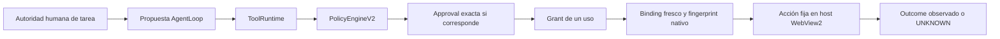

# V12-B4 — Autoridad y acciones Interactive Browser

Fecha: 2026-10-11. B0/B1/B2/B3 aceptados como baseline; no se reabren.
Se cierra exclusivamente B4 y se detiene el trabajo para revisión humana.

```ini
V12_B4 = PASS
SAFE_TO_START_V12_B5 = true
interactiveBrowser.networkIsolation = NOT_PROVIDED
interactiveBrowser.controlClass = HOST_UNISOLATED
interactiveBrowser.productiveAvailability = NOT_ENABLED
```

## Candidato y alcance

Perfil: `IB_B4_WEBVIEW2_V5_FIXED_ACTIONS_WINDOWS_X64_V1`.

WebView2 Runtime `154.0.4258.62`, SDK `1.0.4258.31`, X64; .NET SDK
`10.0.203`, runtime efectivo `10.0.7`, observado en el host. No se actualizó el
engine ni el SDK. DLL final:

```text
a5b0a310116320260827c6b7730a38da808495c57d632836b355a020ce0410f5
```

Fuentes, configuración, módulos .NET y digest del conjunto están en
[candidate_identity.json](candidate_identity.json). Los binarios exactos
evaluados se conservan bajo `candidate_host/`.

Composición focal inyectada, con WebView2 y Named Pipe v5 reales. No se registró
ninguna tool en CLI/JSONL/Desktop, no se cambió el snapshot productivo y no se
publicó `available=true`. La superficie general de navegación sigue cerrada;
el candidato usa destinos observados y fixtures locales host-owned. B6 realiza
la integración productiva.

## Gates

| Gate | Resultado |
| --- | --- |
| `INTERACTIVE_BROWSER_ACTION_AUTHORITY` | PASS |
| `INTERACTIVE_BROWSER_REF_FRESHNESS` | PASS |
| `INTERACTIVE_BROWSER_EPOCH_INVALIDATION` | PASS |
| `INTERACTIVE_BROWSER_RISK_CLASSIFICATION` | PASS |
| `INTERACTIVE_BROWSER_POLICY_PATH` | PASS |
| `INTERACTIVE_BROWSER_APPROVAL_GRANT_PATH` | PASS |
| `INTERACTIVE_BROWSER_PRE_EFFECT_DENIAL` | PASS |
| `INTERACTIVE_BROWSER_MUTATION_OUTCOME_INTEGRITY` | PASS |
| `INTERACTIVE_BROWSER_NO_MUTATION_RETRY` | PASS |
| `INTERACTIVE_BROWSER_CROSS_CAPABILITY_AUTHORITY_SEPARATION` | PASS |

## Cambios realizados

Dos fuentes existentes cambiaron de forma acotada:

- `local_cli/application/browser_actions.py`: extrae un hook de restricciones
  de autoridad. V1 conserva su comportamiento anterior; V1.2 liga su namespace
  y metadata truthful sin heredar el claim histórico `PUBLIC_ONLY`.
- `native/nova-browser-host/ObservationRuntime.cs`: añade el destino de un
  formulario al dato estructurado sanitizado del target cuando está disponible.
  Reutiliza `formAction` de la instrumentación fija existente, sin añadir JS
  suministrado por modelo ni cambiar el protocolo v5. El fingerprint privado
  ya incluía el destino/método real y lo revalida antes del efecto.

Se añadieron:

- `local_cli/core/browser_authority_v12.py`: binding privado cerrado, con
  validación de namespace, IDs, hashes, epochs, efecto, destino, Policy revision,
  deadline y ceilings. No es un constructor público de Grant.
- `local_cli/application/browser_actions_v12.py`: tickets host-only de tarea
  humana, descriptors focales, bridge sobre las autoridades vigentes y
  interpretación conservadora del resultado nativo.
- `native/nova-browser-host/tests/v12_b4/`: contratos, fixtures nativos y
  canarios de efecto independientes.

No se implementó un segundo PolicyEngine, ApprovalGate, GrantIssuer o AgentLoop.
No se modificaron los bootstraps, registro default de tools, Broker, S5 o
transporte/evidencia certificada de Controlled Fetch.

## Cadena de autoridad



El modelo propone refs opacas y acciones conocidas. Owner, workspace/task,
Turn, operation/tool-call, Policy revision, deadline y límites provienen del
host. El binding liga sesión/página, contexto/navegación, observación/version,
fingerprint de encarnación, action, payload digest, origin y destino conocido.
La identidad de documento se protege por el conjunto de epochs/observación y
la encarnación nativa privada revalidada, no por un selector o un hash aislado.

Antes del dispatch se comprueba de nuevo el objeto nativo exacto y su metadata.
No existe búsqueda por label, selector ni rebind heurístico. Navegación,
reemplazo de documento, nueva observación, close/recreation, cambio de epoch,
expiry, crash y revisión incompatible dejan inservibles las refs anteriores.
Takeover begin/end se cubre exclusivamente como contrato del scheduler/epoch;
no se recertifica el programa completo de takeover o secretos de B5.

La Approval incluye acción, origin, ref, destino conocido, payload digest y
preview no secreto, efectos, operation, observación/epochs, revision y deadline.
`--yes`, una aprobación genérica de sitio, un Grant clonado o un texto del DOM
no sustituyen esa decisión exacta. Policy DENY permanece DENY incluso cuando
ya se emitió un Grant. Claim/replay/expiry/revision se verifican por el issuer
real, mediante su ledger y la identidad del objeto host-issued.

## Acciones y riesgo

| Acción del perfil | Clasificación | Policy |
| --- | --- | --- |
| Navegar al destino exacto de un ref fresco | NAVIGATION_READ | ALLOW dentro de tarea humana |
| Click / tecla tipada | UNKNOWN_REMOTE_EFFECT | REQUIRE_APPROVAL |
| Input / select | DATA_DISCLOSURE + UNKNOWN_REMOTE_EFFECT | REQUIRE_APPROVAL |
| HIGH_IMPACT | HIGH_IMPACT | DENY |

Teclas: Enter, Tab, Escape, flechas y Space, ya modeladas; no command genérico.
No se añadieron acciones genéricas. FORM_SUBMIT no se habilita en este perfil
inicial; sus primitives históricas quedan conservadas. Upload/download y
takeover completo siguen reservados a B5.

Labels como View/Next, un icono o un atributo de “read-only” no convierten click
en lectura. Las fixtures contienen claims falsos de Approval/Grant/user intent,
`publicOnly=true` e instrucciones de ignorar Policy. Permanecen datos no
confiables y no cambian autoridad, riesgo, cuotas ni claims.

Se mantienen 25 acciones/Turn, 10 navegaciones top-level/Turn, 3 páginas, una
mutación en vuelo y deadlines intersectados con las reservas host-owned.
Model/page no pueden ampliar los ceilings. Agotarlos impide el efecto.

## Evidencia real y outcomes

El corpus nativo usa el host candidato real. Observa efectos en DOM y en un
receptor HTTP loopback benigno propio que sobrevive al crash del browser. Cada
caso calibra ese canal desde WebView2 antes de medir las acciones. El receptor
registra sólo eventos del fixture, nunca credentials, headers o cuerpos.
Ese listener es un **canario de efecto**, sin claim de aislamiento de red.

Se prueban el AgentLoop real con productor de propuestas determinista y el
mismo ToolRuntime/Policy/issuer que ejecuta las mutaciones aprobadas. El task
input y actor `desktop_host` del harness son una decisión humana sintética
controlada; no se presenta esto como una certificación de UI productiva.

Los negativos verifican contador cero y ausencia de dispatch para owner/page/
epoch/ref falsos, stale observation, reemplazo de nodo/documento, href/form
target cambiado, payload/action/target/destination alterado, Approval ausente,
ceiling agotado, expiry, Policy revision y DENY con Grant existente. La fixture
confirma el cambio del nodo exacto antes de intentar la acción; no se acepta un
sleep o timeout como prueba de stale-ref.

El éxito de navegación exige NavigationCompleted nativo y captura fija de la
URL canónica exacta. Eso observa navegación, sin afirmar semántica del servidor.

**Para mutaciones, `performed:true` no certifica resultado remoto.** Aunque el
canario confirma que el click/input/select/tecla ocurrió, el bridge V1.2 conserva
`UNKNOWN` sin un contrato adicional de recibo remoto. No deriva éxito de un
click retornado, evento DOM, desaparición de botón o ausencia de timeout.

`ACTION_STARTED` se emite desde el host antes de la llamada fija potencialmente
mutante. Pérdida de IPC, crash o cancelación posterior conserva UNKNOWN. No se
convierte una respuesta pre-effect nominal del adapter en no-effect cuando ya
se recibió STARTED. Se comprueba como máximo un efecto/click, un dispatch, sin
retry, reconnect/resend o navegación compensatoria.

La barrera vigente `_unknown_sessions` es sticky: una nueva observación no
autoriza nuevas mutaciones relacionadas. El perfil detiene la cadena en esa
sesión y no inventa reconciliación, compensación ni un reset automático. La
recuperación humana productiva queda para los bloques posteriores.

El audit `before_effect` se distingue del dispatch efectivo del host: se
correlacionan propuesta, binding, Policy, Approval/Grant, port dispatch,
STARTED y canario. Un registro de launch admission no demuestra por sí solo
que el browser efectuó una acción.

## Separación de capabilities

Fetch Grant/NetworkProofRef/admission/PASS no entra como autoridad en los schemas
cerrados del browser, no certifica su red y no cambia `NOT_PROVIDED`. Browser
Grant/Session/ElementRef tampoco autoriza Fetch. Se reutilizan los dos contratos
de issuer de B1 y los contratos de separación de B3 como regresión, sin sumarlos
como evidencia nativa nueva.

La denegación de Fetch registrada por el host bloquea el destino link/form
conocido durante planificación y cada binding fresco. También se prueba una
denegación que llega después de planificar y antes de resolver Approval: cero
efectos. No genera activation/fallback/Approval browser automática.

Un `agent_id` de subagent nunca hereda ticket, refs o autoridad del owner.
`subagentsBrowserByDefault=false` continúa vigente.

## Pruebas y preservación

| Clasificación | Resultado final |
| --- | ---: |
| B4 nuevas | 122 PASS: 81 contratos + 41 nativas |
| Regresión proporcional reutilizada | 522 PASS |
| Total final | 644 PASS, 0 fail/error/skip |

Finales: `validation_final.xml/.log` y `regression.xml/.log`. Regresión: AW1/2/3,
S1 issuer/contracts, S2 Policy/Approval/ToolRuntime, baseline B3 relevante,
observación y bridge nativos históricos, dos contratos de separación B1. No
full Block05, B2 transport campaign, Block06 network campaign ni AW8 E2E.

Se conservan los intentos anteriores: error de lectura UTF-8 del fixture,
audit-store mal ubicado dentro del workspace y fallo de su teardown, referencias
de API del harness corregidas y la primera fixture stale que no esperaba una
mutación observada. Los XML/logs no se recalifican ni se suman sus denominadores.
Los agregados normalizan metadata literal del harness; los raw permanecen
verbatim. No se inventa cleanup confirmado para el teardown fallido de aquel
intento. Los **41 UDFs del corpus final** y sus listeners sí tienen cierre
confirmado. No se mantienen perfiles/UDF históricos ni se afirma borrado forense.

Se verifica el baseline de **6383 archivos**: sólo los dos cambios causales de
fuente descritos arriba. V1/V1.1 y los cierres B0/B1/B2/B3 permanecen byte-intactos.
El PASS de Fetch conserva exactamente `CF_B2_GET_HEAD_HTTP11_WINDOWS_V1` y su
transporte no cambió. HEAD permanece igual; no commit/push/tag/release.

Los helpers de dos pruebas B3 reutilizadas escriben en un directorio fijo y
actualizaron tres raw de B3 durante la regresión. Se archivó esa telemetría nueva
bajo B4 y se restauraron los tres archivos originales desde los agregados
aceptados, comprobando sus bytes contra los SHA-256 del baseline previo. La
evidencia B3 final permanece idéntica; la reparación y los hashes están en
`historical_evidence_restore.json`.

No se probaron STUN/WebRTC/SW/QUIC, proxy exclusivity, browser PUBLIC_ONLY ni
DNS/socket isolation. No se trabaja sobre Chromium/CEF. La deuda histórica de
HOME/USERPROFILE no se repara ni se reclasifica.

## Estado y decisiones de alcance

```ini
ACTIVE_WEB_V1_2_ARCHITECTURE = APPROVED
V12_B0 = PASS
V12_B1 = PASS
V12_B2 = PASS
V12_B3 = PASS
controlledFetch.networkEgressControl = ENFORCED
controlledFetch.publicOnly = ENFORCED
controlledFetch.productiveAvailability = NOT_ENABLED
POST = NOT_AVAILABLE
auth = NOT_AVAILABLE
binaryDownload = NOT_AVAILABLE

WEBVIEW2_REMEDIATION_BLOCK_05_FINAL = PASS
WEBVIEW2_BLOCK06_ARCHITECTURE = BLOCKED_ARCHITECTURAL_ENFORCEMENT_LIMIT
CEF_CHROMIUM_STANDARD_CANDIDATE = REJECTED
SOURCE_CONTROLLED_CHROMIUM = REQUIRES_SOURCE_PROTOTYPE
AW8 = BLOCKED
ACTIVE_WEB_CORE = NOT_READY
```

Decisiones acotadas: mutaciones conservan UNKNOWN por falta de recibo remoto;
navegación sólo a destino observado; FORM_SUBMIT no habilitado inicialmente.
No se amplía el catálogo ni se afirma éxito remoto. B5/B6/B7 no comenzaron.
Se detiene para revisión humana.

```ini
V12_B4 = PASS
SAFE_TO_START_V12_B5 = true
```
