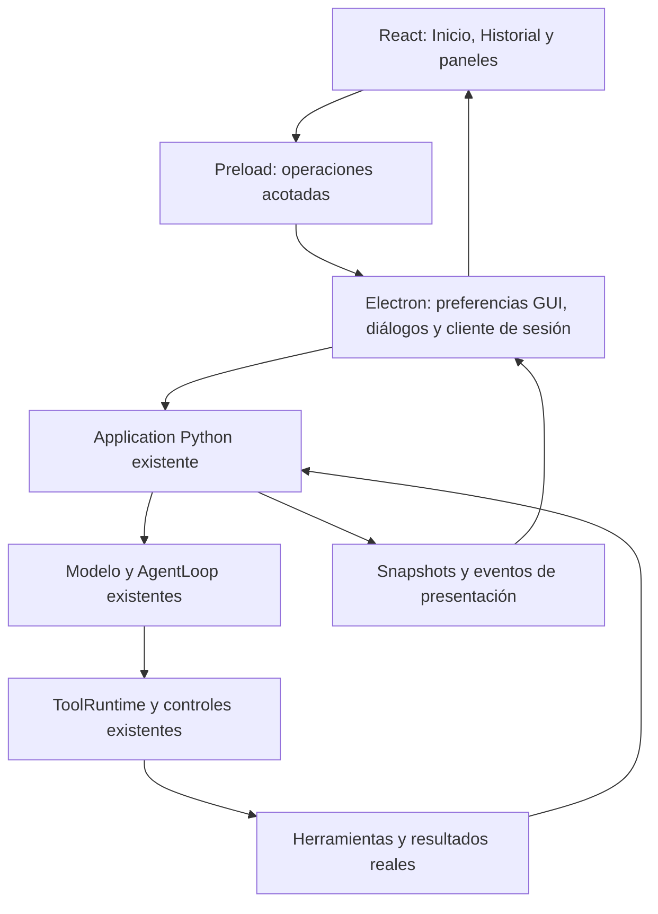

# Propuesta de GUI de Nova y bloques de implementación

Fecha: 2026-10-15. Proyecto: `C:\Users\joseh\Downloads\nova-min\nova-assistant`.

Documento de apoyo: [auditoría del Desktop actual](01_auditoria_desktop_actual.md).

## 1. Objetivo y alcance

Refactorizar el Desktop heredado de Local CLI para ofrecer la presentación de Nova de las referencias: Inicio compacto con órbita dorada, Historial de conversación, panel de Proyectos, catálogo de Modelos y Ajustes organizados por dominio.

Se reutilizarán la sesión de Application, el agente y las herramientas existentes. El modelo seguirá eligiendo sus acciones; el host seguirá controlando disponibilidad, permisos y efectos. Navegar por la GUI no debe cambiar estas responsabilidades.

**Esta entrega es una propuesta, no una implementación.** No incluye voz, MCP, un motor 3D, nuevos navegadores, formatos de documentos nuevos, empaquetado, compilación de ejecutables ni publicación. No modifica CLI ni evidencia histórica. Windows será el entorno de aceptación inicial.

### Referencias e interpretación

| Referencia proporcionada | Uso en Nova |
|---|---|
| 1, 2 y 3: ajustes de otros productos | Estructura: navegación de secciones a la izquierda, opciones agrupadas a la derecha. No copiar su catálogo de funciones. |
| 4: «Panel futurista Nova con órbita dorada» | Vista inicial, rail lateral, fondo, órbita, compositor y estado superior. |
| 5: «Interfaz de historial en modo oscuro» | Conversación: usuario a la derecha, Nova a la izquierda; mismo compositor. |
| 6: «Nova: Panel de Proyecto Futurista» | Drawer con árbol, carpeta actual y menú contextual. |
| 7: «Catálogo de modelos en Nova» | Modal central con tabs, filtros, catálogo y operaciones reales. |

La distribución de Historial sigue la imagen 5: usuario a la derecha y Nova a la izquierda. La mención duplicada de «derecha» en la petición se interpreta con esa referencia visual.

## 2. Arquitectura propuesta

| Dueño | Responsabilidad |
|---|---|
| React | Vista activa, modales, borradores, filtros y representación de estado confirmado. |
| Electron | Ventana, picker nativo, abrir carpeta, preferencias de presentación, superficie de consentimiento y puente autenticado. |
| Application | Sesión, workspace activo, modelos/proveedores, operaciones, mensajes, disponibilidad y resultados reales. |
| Runtime/servicios actuales | Policy, Approval, Grant, ejecución, Memory, Knowledge y capacidades web. |

Un solo cliente de sesión vivirá durante la ventana. Inicio e Historial consumirán la misma conversación. Un modal no creará otro agente, no cancelará una operación al desmontarse y no tendrá una copia independiente de configuración efectiva.

### Organización orientativa

La implementación puede dividir `App.tsx` en `NovaShell`, `HomeView`, `HistoryView`, `Composer`, `ReadinessNotice`, `ActivityCard`, `ProjectDrawer`, `ModelDialog` y `SettingsDialog`. Un `ModalHost` compartido gestionará foco y cierre. Los nombres son orientativos; no exigen una librería nueva ni otro framework de estado.

Se ampliarán los DTO de Desktop únicamente para información que falta: preparación observada, mensajes públicos finalizados con identidad estable, timestamps y resultados de herramienta tipados. Son proyecciones, no una nueva máquina de estados del agente.

## 3. Lenguaje visual

- Fondo azul casi negro, superficies oscuras semitransparentes, bordes discretos y acento ámbar/dorado. El brillo se concentrará en órbita y selección activa.
- Tipografía de interfaz legible; monoespaciada para código, comandos y rutas. Usar fuentes locales/del sistema; no introducir descargas para dibujar la interfaz.
- Rail estrecho: Inicio, Proyectos, Modelos y Ajustes anclado abajo. Tooltips y etiquetas accesibles localizadas.
- Órbita mediante SVG/CSS local, con movimiento discreto opcional según `prefers-reduced-motion`. No es un visualizador de voz ni un modelo 3D.
- Compositor redondeado y persistente: adjuntar mediante Knowledge existente, borrador, modelo efectivo y enviar/detener. El modelo de la referencia no se hardcodea.
- Historial desplazable sin que desaparezcan el compositor ni los permisos pendientes. Contraste y foco visibles; el dorado no será la única señal de estado.
- El drawer de proyectos reduce el área útil sin superponer controles esenciales. En ventanas estrechas puede convertirse en panel superpuesto con cierre explícito.
- Se elimina el menubar de Electron. Se conservan inicialmente el frame y los controles nativos de ventana; no se necesita una titlebar personalizada.

Se validará a 1000×700, un tamaño cómodo cercano a las referencias y el mínimo declarado por la aplicación (actualmente 600×400). Si un modal no cabe, usará scroll interno; no se perderán botones ni foco. Incluir escalado Windows de 125–150 %.

## 4. Preparación real y configuración mínima

«Listo» significa que el chat local puede utilizarse, según una observación reciente del host:

1. El backend y la sesión están conectados.
2. Ollama está accesible para el perfil local seleccionado.
3. Existe un modelo de conversación seleccionado, instalado y compatible con el proveedor actual.
4. No existe un error de inicialización que impida enviar una petición.

No se descargará ni elegirá silenciosamente un modelo. La disponibilidad de Browser, búsquedas remotas, Memory semántica o RAG opcionales no determina este indicador global.

El `ready` actual del cliente seguirá significando preparación del protocolo. Se añadirá una proyección específica de disponibilidad de chat, observada en Application mediante las operaciones de proveedor existentes. React no deducirá preparación del nombre del modelo o de un snapshot recibido.

| Estado observado | Etiqueta superior | Aviso sobre el compositor | Acción |
|---|---|---|---|
| Comprobación inicial | No listo, con indicación «Comprobando…» | Estado breve de comprobación. | No mostrar éxito anticipado. |
| Backend desconectado | No listo | «No se pudo conectar con el servicio de Nova.» | Recuperación/diagnóstico existente; conservar borrador. |
| Ollama inaccesible | No listo | «Termina la configuración» / «Ollama no está disponible. Inícialo y vuelve a intentarlo.» | **Sin botón Abrir configuración.** |
| Ollama accesible, sin modelo seleccionado/instalado | No listo | «Termina la configuración» / requisito concreto pendiente. | «Abrir configuración» lleva a Modelos/Conexión pertinente. |
| Modelo seleccionado inválido o eliminado | No listo | Explicar qué modelo falta. | Abrir el mismo selector de modelos. |
| Todo operativo | Listo | Sin aviso de configuración. | Enviar habilitado. |
| Turno activo o permiso pendiente | Listo si la infraestructura sigue operativa | «Pensando», actividad o tarjeta de permiso. | Detener/resolver, según operación; no mostrar un fallo de configuración. |

Se actualizará la observación al iniciar, reconectar, cambiar proveedor/modelo y detectar un fallo pertinente. Las comprobaciones se limitarán para evitar polling agresivo. Ajustes y Modelos siempre podrán abrirse para reparar la configuración; no se condicionarán a que Nova ya esté «Listo».

La selección aceptada del modelo se persistirá mediante el host para siguientes arranques. El arranque respetará la precedencia existente de opciones explícitas de ejecución y no modificará los archivos personales de CLI como efecto secundario de abrir un modal.

## 5. Inicio compacto, Historial y mensajes sin leer

### Inicio

- Abrir en Inicio con órbita, estado y compositor.
- Ocultar el icono de Historial mientras no exista conversación aceptada.
- Mostrarlo al aceptar el primer mensaje, o al restaurar explícitamente una conversación anterior. La mera existencia de un archivo de sesión no inicia una conversación visual ni crea notificaciones.
- Enviar con Enter conserva Inicio. Shift+Enter inserta línea y se respeta IME.
- Limpiar el borrador sólo después del receipt aceptado. Un rechazo conserva texto y attachments pendientes válidos.
- Mientras trabaja el modelo, mostrar actividad discreta. Aprobaciones y preguntas que bloqueen el turno aparecerán también aquí, aunque el Historial esté cerrado.

### Notificación del Historial

Se cuenta cada **mensaje público del asistente finalizado y nuevo** recibido mientras Historial está oculto. No se cuenta cada token, evento de thinking, tool call, resultado de herramienta o actualización de estado.

La unidad es el mensaje público, no el turno: si Nova emite una breve explicación antes de una herramienta y después una respuesta final como dos mensajes públicos separados, son dos respuestas notificables. Un texto que se actualiza por streaming sigue siendo un solo mensaje.

Se requiere identidad estable del mensaje/segmento público y un watermark de lectura por sesión en preferencias Desktop. Replay, snapshot y reconexión no incrementarán de nuevo respuestas ya conocidas. Al entrar en Historial se pone a cero la burbuja y desaparece; mientras esté visible las respuestas nuevas se consideran vistas. Al volver a Inicio sólo cuentan las posteriores. Restaurar una sesión antigua no convierte todo el transcript en mensajes nuevos.

### Historial

Se mostrará la conversación real, con timestamps observados/persistidos y Markdown seguro. Si una entrada histórica carece de hora, se omitirá; no se inventa.

Los mensajes públicos breves del modelo son burbujas normales. Debajo se agrupan actividades plegables ligadas a `toolCallId`, con herramienta, estado y detalles. «Pensando» describe actividad entre resultados; nunca se mostrará razonamiento interno del modelo.

El control superior permite volver a Inicio sin detener el turno ni borrar mensajes. Este Historial muestra la conversación actual; no se añadirá en este bloque un gestor nuevo de múltiples chats históricos.

## 6. Herramientas, tiempo real, permisos y fallos

### Representación de actividad

| Evidencia del host | Presentación normal |
|---|---|
| Generación activa sin llamada | «Pensando…». |
| Herramienta iniciada | «Leyendo…», «Ejecutando comando…», etc., derivado de la operación real. |
| Resultado exitoso | Resultado plegable y estado de ejecución confirmado. |
| Denegado/fallido/no disponible | Explicación breve; detalles y código bajo diagnóstico. |
| Efecto incierto `UNKNOWN` | «No se pudo confirmar el resultado». Sin check de éxito ni reintento automático. |
| Desconexión | Aviso de conexión; conservar el último estado conocido y el borrador. |

No interpretar una respuesta del modelo como receipt de ejecución. Los errores técnicos no deben exponerse como `[harness] error_stop` en la vista normal. Una misma condición terminal tendrá una sola representación principal, evitando duplicar la tarjeta y una respuesta idéntica.

Los eventos actuales permiten inicio/final reales. Para la salida de terminal en crecimiento solicitada, el bloque de actividad añadirá un canal **acotado** de progreso stdout/stderr desde la infraestructura existente, sin cambiar la semántica de ejecución, los límites ni los permisos. Esto puede requerir un callback de progreso en el launcher o puerto actual. Los fragmentos llevarán identidad de operación y secuencia, tendrán límite de bytes/frecuencia y se representarán como texto; no se renderizarán como HTML ni instrucciones. No se publicarán secretos ni datos que el contrato actual excluya de salida. La salida final seguirá siendo el reporte autoritativo. Si una herramienta no ofrece salida incremental, se mostrará su estado real sin animar una transcripción ficticia.

### Una sola confirmación de permiso

La aprobación aparecerá en una superficie flotante encima del compositor, visible tanto en Inicio como en Historial. Mostrará acción, comando/ruta/destino pertinente y contexto de ejecución, con «Permitir» y «No permitir»; en inglés, «Allow» y «Deny».

La solución propuesta para mantener el consentimiento del host es una **superficie local de aprobación aislada y creada por Electron**, por ejemplo una ventana hija/sheet alineada con el compositor, con contenido fijo, sin navegación remota y con IPC propio. El renderer principal sólo proyecta la solicitud pendiente; no puede convertir su propio booleano en consentimiento firmado.

Main aceptará la decisión únicamente desde esa superficie para la solicitud exacta, vigente y de la sesión actual; volverá a validar antes de emitir la respuesta autenticada. El material de firma permanece privado. Conservar correlación de `approvalId`, `toolCallId`, digest, cwd, revisión de Policy, sesión y deadline. Un cambio de argumentos, sesión o plazo invalida la decisión; un doble clic no ejecuta dos veces.

Esa interacción sustituye la doble confirmación actual por una elección humana única. No se quitará la confirmación nativa hasta que la superficie equivalente pase los contratos de host. No se añaden autoaprobaciones ni permisos persistentes como consecuencia de marcar una casilla de presentación.

Las preguntas del agente usarán su mecanismo de respuesta existente y se distinguirán de un permiso. Cerrar Modelos/Ajustes no aprobará, denegará ni cancelará una herramienta. Un permiso pendiente necesitará decisión explícita o expiración según el contrato actual.

## 7. Proyectos y carpeta predeterminada

### Alcance inicial

Se mantiene **un workspace efectivo activo**, con un listado de carpetas recordadas por Desktop si el usuario añade varias. No se simulará acceso multi-root: cada árbol corresponde al proyecto activo confirmado por Application.

La propuesta para el predeterminado es `<NovaRoot>\workspace\`, una carpeta dedicada dentro de la raíz de esta aplicación/proyecto. Su ruta exacta la resolverá el host; no dependerá del cwd accidental del lanzador. No se tratará todo el source tree de Nova como carpeta con acceso por defecto.

Si esa carpeta no puede crearse o utilizarse, se explicará el error y se solicitará elegir otra. No se moverán datos ni se concederá acceso a una ruta alternativa silenciosamente. El esquema de instalación futura queda fuera del alcance actual.

### Operaciones

| Acción | Comportamiento |
|---|---|
| Icono de carpeta | Abrir/cerrar drawer; conservar conversación y estado. |
| «+» / Añadir carpeta | Picker nativo; validar carpeta y cambiar mediante Application. Actualizar la UI tras receipt aceptado. |
| Cambiar, desde «…» | Elegir nueva carpeta. Cancelar mantiene exactamente proyecto y permisos previos. |
| Quitar | Retirar la carpeta del listado/acceso de proyecto. **No borrar archivos.** Si era activa, activar el predeterminado mediante cambio confirmado; si falla, conservar estado y explicar. |
| Abrir en el Explorador | Host obtiene la ruta del proyecto confirmado y usa `shell.openPath`. No ejecutar un comando arbitrario del modelo. |
| Expandir/previsualizar | Reutilizar árbol/visor actuales, límites de tamaño, paginación y manejo de enlaces. |

El host bloqueará cambios incompatibles con un turno activo o una interacción pendiente. No se reanclarán aprobaciones a otro cwd. Las lecturas de vista previa verificarán sender y pertenencia a la raíz canónica seleccionada; las herramientas del agente conservarán sus controles actuales.

## 8. Modelos: modal central

El botón del cerebro abrirá el gestor completo. El selector del compositor será exclusivamente un combobox de modelos ya instalados en Ollama; no abrirá el catálogo ni ofrecerá descargas. Esta separación incorpora la aclaración posterior del usuario. Fondo atenuado; cierre por clic fuera, Escape o X; foco atrapado dentro y devuelto al disparador al cerrar.

Reutilizar las funciones actuales:

- Para ti: recomendaciones y hardware realmente observado.
- Catálogo: filtros, categorías, metadatos, instalado/seleccionado, sincronización.
- Descubrir: resultados del mecanismo existente, sin atribuir capacidades no verificadas.
- Instalar/eliminar y progreso: operaciones existentes, con error y cancelación sólo cuando estén soportados.

Descargar no cambia automáticamente el modelo activo. Seleccionar requiere confirmación de Application y persiste la preferencia aceptada. Un rechazo mantiene el modelo anterior y muestra la causa. El modal puede cerrarse mientras descarga sin cancelarla; al reabrir reconstruye su estado desde la operación vigente.

No se crearán ratings, precios, compatibilidades o modelos a partir de la imagen. El texto de terceros se tratará como dato y puede conservar su idioma; los títulos, acciones y mensajes propios de Nova estarán en el idioma elegido.

## 9. Ajustes formales y aislados

Modal central con columna izquierda de secciones e iconos y columna derecha de opciones. ES será el idioma inicial de GUI y EN la alternativa. El cambio afecta interfaz, avisos de Desktop, formatos y diálogos propios; no traduce conversaciones, salidas de herramientas ni impone inglés/español al modelo. CLI permanece en inglés.

| Sección | Opciones/estado de esta etapa | Dueño y aplicación |
|---|---|---|
| General | Idioma ES/EN; información de comportamiento del compositor y atajos disponibles. | Preferencias de presentación Desktop; aplicar tras guardar. Apariencia orbital definida, sin inventar un editor de temas. |
| Conexión y modelo | Salud de Ollama, proveedor actual y modelo local activo; acceso al gestor único de modelos. Otros proveedores existentes pueden quedar en opciones avanzadas sin ampliar soporte. | Application valida conexión/cambios; el host persiste selección. No almacenar credenciales nuevas en el JSON visual. |
| Proyectos | Proyecto actual, predeterminado y acciones del panel. | Registro Desktop y workspace Application; operaciones del apartado 7. |
| Web y navegador | Selección/estado y controles de las implementaciones actuales; fetch y búsqueda opcional tal como existan. | Operaciones existentes de backend mediante puente validado. Una preferencia no afirma que el runtime esté operativo ni aprueba efectos. |
| Memoria | Consulta y controles de Memory que ya existen, con su confirmación correspondiente. | Memory/Application; preferencias por sus contratos actuales. No reconstruir su almacenamiento. |
| Documentos y conocimiento | Attachments/fuentes, estados y acciones Knowledge actuales; RAG y sus controles existentes. | Knowledge/Application; no añadir formatos, importación automática ni motores nuevos. |
| Acerca de y diagnóstico | Versión Nova, backend, errores de conexión y diagnóstico acotado. | Host; información copiable sin secretos. Actualización heredada aislada hasta existir destino Nova aprobado. |

No se copiarán cuentas, suscripciones, voz, plugins, worktrees, hooks ni switches de «acceso completo» de los ejemplos. Tampoco se ofrecerá una opción cuyo efecto no tenga una operación backend real.

### Persistencia y validación

- Conservar el directorio Desktop actual: en Windows, `%APPDATA%\nova-desktop`, establecido por Electron. Separar dentro de él preferencias de presentación de referencias de proyectos y preferencias de runtime, con esquema pequeño y validación por dominio.
- Usar las fuentes actuales de configuración de Memory/Knowledge/web; no crear una segunda copia efectiva en localStorage. Datos de sesión/conversación siguen en sus almacenes existentes.
- Credenciales permanecen en su mecanismo privado actual, nunca en texto plano en preferencias GUI.
- Preferencias de interfaz se guardan desde main; las de servicios se aplican por comando Application y sólo se presentan como activas tras receipt. Un fallo de escritura/cambio conserva lo efectivo anterior.
- Formularios con borrador por sección, Guardar y Cancelar. Clic fuera/Escape descarta el borrador no guardado de forma consistente; la UI indicará «Los cambios se aplican al guardar». Operaciones ya iniciadas —por ejemplo una descarga— continúan y no son un borrador de formulario.
- Un deep link «Abrir configuración» abre la sección que resuelve el requisito pendiente; no crea otro panel duplicado.

Un único modal funcional abierto a la vez. Las solicitudes de aprobación tienen prioridad y no quedan ocultas detrás de Ajustes. La navegación de paneles no reinicia el backend.

## 10. Bloques de implementación

Los bloques son entregas de producto verificables. No son etapas HUX ni certificaciones. Antes de cada bloque se conserva una base ejecutable; los cambios de UI se incorporan junto con las pruebas de su flujo, sin reescribir el agente.

### GUI-B1 — Estructura visual y base de idioma

**Objetivo:** reemplazar el shell de terminal por el marco visual de Nova.

**Trabajo:** tokens de color/espaciado/tipografía; rail; Inicio orbital local; compositor base; header de estado provisional claramente identificado; infraestructura ES/EN; ModalHost accesible; retirada del menubar. Conservar frame nativo y shortcuts. Aislar desde este bloque la consulta/instalación automática de actualizaciones upstream ajenas a Nova.

**Reutilizar/tocar:** `desktop/src/App.tsx`, `styles.css`, componentes nuevos pequeños, `desktop/electron/main.ts` y metadatos visibles. Conservar licencias/atribuciones aplicables. No activar empaquetado ni alterar appId/almacenes personales sólo por branding.

**Salida verificable:** Inicio reconocible como referencia 4, rail y modales navegables por teclado, ninguna voz/3D, ninguna llamada al agente por cambiar vista, menubar ausente, controles de ventana y copiar/pegar operativos. Textos nuevos usan claves ES/EN.

**Dependencia:** ninguna posterior. No afirmar «Listo» por un mock de esta fase.

### GUI-B2 — Preparación real y primer uso

**Objetivo:** abrir Nova y saber exactamente qué falta antes de enviar.

**Trabajo:** proyectar salud real del backend/Ollama y validez del modelo; indicador Listo/No listo; aviso contextual; acceso al selector local ya existente; selección persistida por el host. Separar preparación de protocolo de disponibilidad para chat.

**Reutilizar/tocar:** `application_client.ts`, `shared/application.ts`, providers/snapshot Python sólo donde falte la observación; selector ModelPicker existente y nuevo ReadinessNotice. No cambiar parámetros de inferencia por motivos visuales.

**Pruebas de salida:** Ollama detenido → No listo y aviso sin botón; Ollama activo sin modelo → abrir selector por deep link; modelo elegido y aceptado → Listo; modelo eliminado/backend caído → estado honesto y borrador intacto; Browser/RAG ausente → chat local sigue preparado; configuración accesible cuando no está listo; reinicio conserva selección aceptada.

**Dependencia:** B1. La presentación completa del catálogo se termina en B6; aquí se reutiliza su selección actual para no bloquear el primer uso.

### GUI-B3 — Inicio compacto, conversación e Historial

**Objetivo:** mantener la interacción minimizada por elección del usuario, con mensajes y notificaciones fiables.

**Trabajo:** dos vistas de una misma sesión; burbuja de respuestas sin leer; identidad y finalización de mensajes públicos; timestamps; composer con receipt, attachments y detener; restauración explícita de conversación.

**Reutilizar/tocar:** `use_session_view.ts`, `application_client.ts`, `types.ts`, DTO y proyección de transcript si es necesario; Markdown y componentes de conversación. No recrear Application al cambiar vista.

**Pruebas de salida:** icono oculto al inicio; enviar no navega; respuesta pública finalizada suma una vez; dos mensajes públicos independientes suman dos; tokens/herramientas/replay no suman; entrar en Historial borra contador; volver a Inicio conserva sesión; envío rechazado mantiene borrador; IME/Shift+Enter correctos; cerrar panel no interrumpe turno.

**Dependencia:** B2.

### GUI-B4 — Actividad, salida y consentimiento único

**Objetivo:** ver herramientas y permisos sin confundir actividad con éxito.

**Trabajo:** transportar IDs/outcomes reales; tarjetas plegables bajo el mensaje público; estado Pensando sin razonamiento privado; salida incremental acotada de procesos; errores normales traducidos y detalles técnicos separados; tarjeta de permiso controlada por el host sin segundo popup. Conservar preguntas y cancelación.

**Reutilizar/tocar:** `MessageBlock.tsx`, proyección Python `_observe_display`, DTO/eventos, salida del ejecutor sólo como canal de progreso, `approval_host.cjs`, main/preload y una superficie local de aprobación aislada.

**Pruebas de salida:** inicio visible antes de terminar comando; salida incremental ordenada y bounded; fallo/denegación/UNKNOWN sin check falso; texto público del modelo separado de actividad; un permiso = una elección humana; decisión siempre ligada a solicitud vigente; renderer principal no puede autoaprobar; digest/sesión/plazo cambiados → rechazo; negar no ejecuta; desconexión no reintenta una mutación incierta; aviso terminal no duplicado. Permisos visibles también desde Inicio.

**Dependencia:** B3. La sustitución de la confirmación nativa se entrega junto con sus negativos de autoridad, no antes.

### GUI-B5 — Proyectos y explorador de Nova

**Objetivo:** administrar la carpeta de trabajo desde el drawer de la referencia 6.

**Trabajo:** predeterminado administrado `workspace/`; añadir/cambiar/quitar; menú de tres puntos; abrir Explorador; selección confirmada por host; árbol/visor restilizados; nombres Windows correctos; IPC de vista previa ligado a proyecto/sender. Persistir carpetas recordadas sin simular multi-root.

**Reutilizar/tocar:** FileExplorer, FileViewer, handlers main/preload, cambio de workspace Application y registro mínimo Desktop.

**Pruebas de salida:** primer inicio usa predeterminado dedicado; picker cancelado conserva raíz; carpeta inaccesible produce error; cambio rechazado durante turno no altera selección; Quitar no borra datos; retirar activa vuelve al predeterminado sólo con éxito host; abrir Explorador usa carpeta confirmada; preview de otra raíz no se admite; límites/tipos y enlaces se respetan.

**Dependencia:** B3 y coordinación con solicitudes de B4. No se cambia Policy para obtener un árbol más bonito.

### GUI-B6 — Catálogo y gestión visual de modelos

**Objetivo:** convertir el gestor existente en el modal de la referencia 7.

**Trabajo:** Para ti/Catálogo/Descubrir; filtros y categorías; información real; instalar/eliminar/sincronizar y progreso; selección explícita; responsive, foco y cierres; selector del compositor coherente con el backend.

**Reutilizar/tocar:** ModelPicker, App, servicios existentes del servidor; mejoras focales de la proyección de progreso si faltan datos tipados.

**Pruebas de salida:** cerebro abre el modal y atenúa fondo; clic fuera/Escape/X regresan a la vista anterior; filtrar no cambia modelo; descarga no selecciona sin petición; fallo de ChangeModel conserva anterior; cerrar no cancela descarga; reabrir recupera progreso; etiquetas ES/EN sin modificar metadatos de terceros.

**Dependencia:** B1–B3; usa el contrato de selección/persistencia de B2, sin duplicarlo.

### GUI-B7 — Ajustes por dominio y controles existentes

**Objetivo:** disponer de configuración clara con el patrón de navegación izquierda/contenido derecho.

**Trabajo:** secciones del apartado 9; preferencias validadas por dominio; puente a controles actuales web/Memory/Knowledge/RAG; diálogos Desktop localizados; deep links; diagnóstico separado. Garantizar que ningún botón de actualización apunte a upstream por accidente.

**Reutilizar/tocar:** SettingsPanel, preload/main, DTO y operaciones existentes, stores pequeños de preferencias GUI; mantener mecanismos privados para credenciales y consentimientos sensibles.

**Pruebas de salida:** ES predeterminado, EN guardado sobrevive reinicio; CLI y contenido del modelo no cambian de idioma; cancelar conserva efectivo; una sección no sobrescribe otra; datos inválidos generan mensaje; estado de servicio no se inventa desde un toggle; Modelos abre gestor único; controles Memory/Knowledge existentes conservan su confirmación; no aparece ninguna opción de las referencias sin implementación real.

**Dependencia:** B2, B4, B5 y B6 para enlazar las operaciones definitivas.

### GUI-B8 — Comprobación integrada Windows y cierre documental

**Objetivo:** comprobar la experiencia completa y corregir bugs pequeños causados por la refactorización.

**Trabajo:** corpus práctico de flujos del apartado 11, accesibilidad/foco, escalado, reconexión, reinicio/persistencia y localización; regresión focal del puente Application/CLI/Memory/Knowledge/Approval afectado; actualizar documentación de inicio y configuración. Registrar lo no comprobado.

**Pruebas/entrega:** validación de TypeScript y renderer, pruebas deterministas del cliente/host, smoke manual Electron Windows y unas pocas tareas con el modelo local actual para verificar integración. Sin descargas de modelos automáticas, benchmarks masivos, nueva certificación Active Web/HUX ni cambios de parámetros para maquillar resultados.

**Salida:** checklist con resultados reproducibles y pendientes concretos; comandos de desarrollo verificados. No usar `npm run build` indiscriminadamente como simple chequeo: hoy incluye `electron-builder`; separar comprobaciones de fuente/bundle del empaquetado. Sin `.exe`, instalador, staging, commit o release.

**Dependencia:** B1–B7. Si un flujo falla, corregir su causa y repetir la prueba pertinente; no ampliar a una campaña ajena a GUI.

## 11. Matriz de aceptación integrada

| ID | Flujo verificable | Bloque |
|---|---|---|
| UX-01 | Arranque sin Ollama: No listo, requisito explicado, sin Abrir configuración para ese caso. | B2, B8 |
| UX-02 | Ollama disponible sin modelo: abrir selector; seleccionar local; Listo; reiniciar y conservar selección. | B2, B6, B8 |
| UX-03 | En Inicio enviar «Hola»: permanece compacto; icono aparece al aceptar; respuesta completada muestra burbuja 1. | B3, B8 |
| UX-04 | Entrar en Historial: burbuja desaparece; volver a Inicio no reinicia conversación. | B3, B8 |
| UX-05 | Preamble público + herramienta + respuesta final: texto legible, actividad plegable y recuento por mensaje público. Replay no duplica. | B3, B4 |
| UX-06 | Comando local: progreso real; un permiso flotante; Allow/Deny por host; no segunda confirmación. | B4, B8 |
| UX-07 | Denegado, fallo y UNKNOWN: estado honesto; sin éxito falso, retry automático incierto ni doble mensaje terminal. | B4, B8 |
| UX-08 | Envío rechazado o backend desconectado: borrador intacto, causa visible y controles recuperables. | B2–B4 |
| UX-09 | Proyecto: añadir/cambiar, cancelar, abrir Explorador, quitar sin borrar archivos y fallback confirmado. | B5, B8 |
| UX-10 | Modelo: descargar sin cambiar activo; seleccionar explícitamente; error conserva anterior; modal cerrado no cancela operación. | B2, B6 |
| UX-11 | Adjuntar/consultar documento y controles Memory/RAG existentes siguen funcionando con el nuevo acceso visual. | B3, B7, B8 |
| UX-12 | Ajustes ES/EN: sólo textos propios, formatos y diálogos; sin cambiar idioma del modelo o CLI. | B1, B7 |
| UX-13 | Teclado, Tab/Shift+Tab, Escape, clic fuera, foco restaurado, contraste y reduced motion. | B1, B6–B8 |
| UX-14 | Cambiar modelo/proyecto durante ejecución se rige por Application; no desajusta cwd, permisos ni vista. | B2, B5, B8 |
| UX-15 | Menubar ausente; controles nativos y shortcuts operan; ventanas pequeñas/escalado no ocultan acciones. | B1, B8 |
| UX-16 | Herramienta Browser opcional no disponible: explicación local; el chat con Ollama sigue Listo. | B2, B7, B8 |

Reutilizar [application_client.test.cjs](../../desktop/tests/application_client.test.cjs), [approval_host.test.cjs](../../desktop/tests/approval_host.test.cjs), pruebas Desktop/Provider de Python y suites actuales Memory/Knowledge. Añadir únicamente cobertura de los contratos UI nuevos. Las capturas finales comprobarán Inicio, Historial, Proyectos, Modelos y Ajustes; los screenshots de referencia no sustituyen pruebas funcionales.

## 12. Riesgos y decisiones explícitas

| Riesgo | Tratamiento propuesto |
|---|---|
| Confundir snapshot válido con modelo listo. | Preparación observada separada de conexión de protocolo; no hardcodear Listo. |
| Perder mensajes/draft al rediseñar App. | Una sesión host; limpiar sólo tras aceptación; IDs y replay existentes. |
| Eliminar consentimiento real al simplificar popup. | Superficie controlada por main con validación exacta y negativos equivalentes antes de quitar el diálogo. |
| Ocultar errores bajo «Done». | Propagar outcome/effectState; UNKNOWN siempre explícito. |
| Convertir «Quitar» en borrar datos o scope ficticio. | Operación host y fallback atómico; cero borrado de archivos. |
| Nuevo diseño deja fuera capacidades existentes. | Trazar Memory/Knowledge/RAG/web a secciones reales; no eliminar operaciones por ocultar widgets antiguos. |
| Lanzar un actualizador del producto equivocado. | Aislar updater upstream al introducir Nova; definir destino propio en otra decisión, sin release ahora. |
| Desviar el trabajo a infraestructura ajena. | No nuevos agentes, routers lingüísticos, capabilities ni campañas históricas; cambios backend sólo para proyección/operaciones UI necesarias. |

Decisiones propuestas para concretar la implementación sin fricción: un workspace activo; predeterminado `workspace/`; idioma GUI inicial ES; frame Windows nativo; órbita SVG/CSS; gestor de modelos único; contador por mensaje público finalizado. No se requiere decidir voz, empaquetado o soporte certificado fuera de Windows para empezar B1.

## 13. Resultado esperado y orden recomendado

Orden: **B1 → B2 → B3 → B4 → B5 → B6 → B7 → B8**. B5 y B6 pueden desarrollarse en paralelo una vez fijados los contratos de sesión, preferencias y modal; su integración se comprueba en B8.

Al finalizar, abrir Nova debe llevar a la vista compacta con estado real; el usuario puede configurar el mínimo, conversar sin entrar al historial, consultar respuestas cuando quiera, aprobar acciones una sola vez y administrar proyecto/modelos desde los paneles solicitados. Los servicios y permisos continúan en el backend existente.

**Entrega actual:** dos documentos de auditoría y propuesta. Ningún bloque de implementación queda declarado completado por la existencia de esta planificación.
